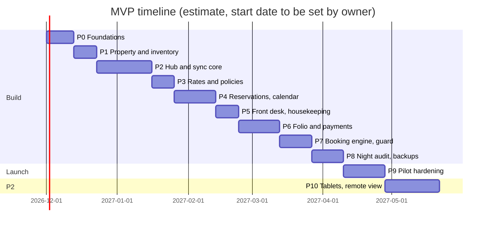

# Sentire PMS: Build Plan

**Version 1.1, 24 November 2026.** Working name "Sentire PMS". This plan turns the Blueprint and System Design into ordered phases that one developer can build with Claude Code. Version 1.1 adds the installed Windows app with a property hub, offline operation and sync with Sentire Cloud, and moves tablets to P2 and macOS to later.

**Owner decisions recorded (24 Nov 2026):** hub plus cloud architecture; Windows desktop with built-in hub first, then Android and iPad tablets, macOS later; online sales stop when a hub has not synced for 10 minutes.

**Durations are estimates**, based on how fast Sentire Projects was built and adjusted upward for money rules, concurrency, offline sync and Windows packaging. They assume about 15 to 20 focused hours a week.

---

## 1. Summary

| Phase | Name | Main outcome | Estimate | Requirements |
|---|---|---|---|---|
| 0 | Foundations | Monorepo, cloud staging on Dokploy, Tauri Windows shell, sign-in, roles, ULIDs, outbox table, CI with Windows build | 1.5 to 2 weeks | FR-39 to FR-41, NFR-05, NFR-06, NFR-12 |
| 1 | Property and inventory | Property setup, room types, rooms, blocks, taxes and fees, inventory engine | 1 to 2 weeks | FR-01 to FR-05, FR-10, NFR-02 |
| 2 | Hub and sync core | Hub mode (bundled Postgres, Windows service), device pairing, outbox and inbox sync, status bar, first sync of property data | 3 to 4 weeks | FR-49 to FR-53, NFR-15 to NFR-18 |
| 3 | Rates and policies | Rate plans, daily rates and restrictions, bulk update, policies | 1 to 2 weeks | FR-06 to FR-09 |
| 4 | Reservations and calendar | Create and edit reservations, room assignment, calendar, search, dashboard | 2 to 3 weeks | FR-11 to FR-19 |
| 5 | Front desk and housekeeping | Check-in, check-out, guest details and IDs, registration card, housekeeping board | 1 to 2 weeks | FR-20 to FR-23 |
| 6 | Folio, payments, invoices | Folios, charges, record-only payments on the hub, pay-by-link and webhooks in the cloud, refunds, hub-numbered invoices | 2 to 3 weeks | FR-24 to FR-30, CR-01 to CR-03, CR-05, CR-07 |
| 7 | Booking engine and sales guard | Cloud booking engine, deposit checkout, delivery to the hub, online sales guard | 2 weeks | FR-32 to FR-34, FR-42, FR-54 |
| 8 | Night audit, reports, backups | Night audit on the hub, 10 reports, hourly local and nightly cloud backups, hub replacement wizard | 2 weeks | FR-36, FR-37, FR-55 |
| 9 | Pilot hardening and release | Signed installer and auto-update with staged rings, offline and load tests, security review, onboarding, pilot go-live | 2 to 3 weeks | NFR-01 to NFR-18, CR-04 |
| | **MVP total (Windows)** | | **19 to 28 weeks** | |
| 10 | P2: Tablets and remote view | Android and iPad hub-client apps (housekeeping first, then front desk), owner read-only cloud view | 3 to 4 weeks | FR-56, FR-57 |
| 11+ | P2 continued | Inbox and SMS, channel manager partner, city ledger, multi-property, scheduled reports, promo codes | Plan after pilot | FR-31, FR-35, FR-38, FR-43 to FR-45 |
| Later | macOS | macOS desktop app (same Tauri code, Apple signing and notarization) | 1 to 2 weeks | FR-58 |

The chart uses 1 December 2026 only as a placeholder start; the owner sets the real date.

**Why sync comes in Phase 2.** Every later module writes through the outbox. Building sync right after the first tables means each module is tested offline as it is built, instead of retrofitting sync at the end, which is the most common way offline products fail.

---

## 2. Working method

1. **Tracking.** Create the product in Sentire Projects (recommended name "Sentire PMS", key PMS). Each task below becomes an issue; each phase becomes a milestone. Every coding session starts with `start_session` and ends with `end_session`.
2. **Branches.** One branch per task (`pms/<issue-key>-short-name`), one pull request per task with "fixes <key>", merged by Claude after CI passes.
3. **Environments.**
   - Cloud staging: `pms-staging.apps.sentire.solutions` (seeded demo property, resettable), deployed on every merge.
   - Cloud production: `pms.apps.sentire.solutions`, deployed at the end of each phase after UAT passes.
   - Hub builds: a signed Windows installer from every merge on the `beta` update channel (test PCs), promoted to `pilot` and then `stable` at the end of each phase.
4. **Test hub.** A Windows test PC or VM runs the beta hub against cloud staging, so offline tests (pulling the network cable, switching off Wi-Fi) are real.
5. **QA connector.** In Phase 0, add a "PMS Staging QA" MCP connector (same pattern as Payroll and Ledger QA) so Claude can seed scenarios and test through the real API, on the cloud and, through the test hub's API, on the hub.
6. **UAT.** Each phase ships a UAT document written by the developing session; Claude runs it as the UAT tester, fixes failures and re-runs until it passes. From Phase 2 onward every UAT includes an offline section.
7. **Definition of done (every task).** Types pass; unit tests for new domain rules; an integration test for the use case; a sync test if the task adds or changes a table; UI matches the mockup; audit log entries written; no secrets in code; UAT cases added.

---

## 3. Phases in detail

### Phase 0: Foundations

| Task | Description |
|---|---|
| P0.1 | Create repo `sentire-pms` as a pnpm monorepo: `apps/web` (Next.js, `hub` and `cloud` modes), `apps/desktop` (Tauri 2 shell), `packages/core` (domain), `packages/db` (Drizzle schema), `packages/sync`, `packages/ui`; add CLAUDE.md, README.md, `.sentire-projects.json`, `.mcp.json` |
| P0.2 | Dokploy: project "Sentire PMS", apps `pms-staging` and `pms` (cloud mode), databases `sentire_pms` and `sentire_pms_staging`, RustFS buckets `pms-files` and `pms-backups`, update server path for releases |
| P0.3 | Drizzle setup with ULID primary keys, migrations, base tables: organizations, properties, users, property_roles, sessions, audit_log, outbox_events |
| P0.4 | Sign-in with Sentire Account via sentire-kit; session cookie; credential cache design for offline sign-in |
| P0.5 | `TenantContext`, `authorize()` and permission list; isolation test |
| P0.6 | Design tokens from sentire-kit, app shell (top bar with connection status, side nav) matching the mockup |
| P0.7 | Tauri 2 Windows shell that opens the app; GitHub Actions Windows runner producing an installer (unsigned for now) |
| P0.8 | GitHub Actions: lint, type-check, unit and integration tests on every PR |
| P0.9 | PMS Staging QA MCP connector with `staging_status`, `seed_scenario`, `api_request` |
| P0.10 | Owner actions started: Windows code-signing certificate, PayMongo and Maya merchant applications, BIR checklist including CR-07 (see section 5) |

**Exit test:** the Windows installer installs on a clean Windows 11 VM, the app opens, the owner signs in with a Sentire Account against cloud staging and creates a property.

### Phase 1: Property and inventory

| Task | Description |
|---|---|
| P1.1 | Property settings page (FR-01) |
| P1.2 | Room types and rooms, including dorm beds (FR-02, FR-03) |
| P1.3 | Room blocks with reasons (FR-04) |
| P1.4 | Taxes, fees and discounts with GL codes; VAT 12% inclusive default (FR-05) |
| P1.5 | `inventory_days` engine: build rows on room changes, `available()` query, lock helper (FR-10, NFR-02) |
| P1.6 | Concurrency test: 20 parallel bookings for the last unit, exactly one succeeds |

### Phase 2: Hub and sync core

| Task | Description |
|---|---|
| P2.1 | Hub mode: bundle Postgres 18 and Node with the Tauri app; install and run the hub as a Windows service that starts with Windows; local data folder and encryption key |
| P2.2 | "Make this PC the property hub" setup flow and first sync (download property data from the cloud) |
| P2.3 | Local network: hub discovery (mDNS) and manual address, per-property TLS certificate, device pairing with one-time code or QR, device tokens and revocation (FR-50, NFR-18) |
| P2.4 | Outbox writer in the data layer (same transaction as every write) and per-hub sequence numbers |
| P2.5 | Cloud sync API: receive outbox batches, acknowledge by `eventId`, keep the cloud mirror, queue events for the hub |
| P2.6 | Hub sync worker: push, pull, apply once (inbox), retry with backoff, resume after outages; `sync_issues` list for rejected events (FR-52) |
| P2.7 | Connection status bar and sync screen for Admins (FR-53) |
| P2.8 | Offline sign-in with cached credentials and roles |
| P2.9 | Sync test suite: random network cuts, hub restarts mid-batch, duplicate deliveries, clock differences; property tables from Phase 1 must match on both sides afterward |

**Exit test:** with the network cable pulled, a second PC paired to the hub edits rooms and rates; after reconnecting, the cloud mirror matches the hub exactly and no event is applied twice.

### Phase 3: Rates and policies

| Task | Description |
|---|---|
| P3.1 | Rate plans: standard, derived, package (FR-06) |
| P3.2 | Daily rates and restrictions and the price calculator for a stay (FR-07) |
| P3.3 | Availability matrix screen (mockup: Rates) |
| P3.4 | Bulk update with preview and one-transaction apply (FR-08) |
| P3.5 | Policies and `penaltyAt()` with unit tests for every guarantee and penalty type (FR-09) |

### Phase 4: Reservations and calendar

| Task | Description |
|---|---|
| P4.1 | Guests: create, search, duplicate suggestion |
| P4.2 | New reservation flow with live availability and cart (FR-11) |
| P4.3 | Reservation state machine with guarded transitions (FR-12) |
| P4.4 | Room assignment and collision rules; unique room-night index (FR-13) |
| P4.5 | Edit dates and rooms with re-pricing (FR-14) |
| P4.6 | Reservation list, filters, global search (FR-16) |
| P4.7 | Notes, documents (stored on the hub, copied to the cloud when online), activity log (FR-17) |
| P4.8 | Calendar: 7, 14, 30 days, bars, drag and drop, drawer, inline rate edit (FR-19) |
| P4.9 | Dashboard: activity tabs, occupancy, forecast (FR-18) |

### Phase 5: Front desk and housekeeping

| Task | Description |
|---|---|
| P5.1 | Check-in flow with room readiness and guarantee checks (FR-20) |
| P5.2 | Guest details, ID capture (webcam or upload) to encrypted hub storage, SC and PWD fields (FR-21, CR-03, CR-04) |
| P5.3 | Registration card printing from the desktop app |
| P5.4 | Check-out flow with balance rule (FR-20) |
| P5.5 | Housekeeping board, touch-friendly layout for tablets in P2, auto Dirty on check-out (FR-22, FR-23) |

### Phase 6: Folio, payments and invoices

| Task | Description |
|---|---|
| P6.1 | Folios and append-only transactions with reversal (FR-24, FR-26) |
| P6.2 | Charge posting (products, adjustments, fees) (FR-25) |
| P6.3 | Record-only payments on the hub (cash, card terminal, bank transfer), working offline |
| P6.4 | Payment provider adapter in the cloud; PayMongo first, Maya second |
| P6.5 | Pay-by-link from the hub: request goes to the cloud when online; webhook confirmations land in the cloud and sync to the hub folio once (FR-27, FR-28) |
| P6.6 | Refunds (FR-29) |
| P6.7 | Invoice sequences on the hub only, invoice issuing with VAT, exempt and SC/PWD lines, invoice printing and PDF (FR-30, CR-01 to CR-03, CR-07) |
| P6.8 | Cancellation and no-show penalties posted from policies (FR-15) |
| P6.9 | Payments page (overview, transactions) |

### Phase 7: Booking engine and online sales guard

| Task | Description |
|---|---|
| P7.1 | Public route `/book/[propertySlug]` in the cloud app, availability from the cloud mirror, room cards (FR-32) |
| P7.2 | Cart, guest form, terms, 15-minute inventory hold in the cloud |
| P7.3 | Hosted checkout for the deposit; confirm on webhook; release on expiry (FR-33) |
| P7.4 | Delivery to the hub: online booking applied on the hub with inventory re-check and overbooking flag |
| P7.5 | Online sales guard: per-hub last-sync check every minute, booking engine closed message, Owner alert by email and SMS (FR-54) |
| P7.6 | Confirmation email and manage-booking link with policy-based cancellation (FR-34, FR-42) |
| P7.7 | Embed snippet for the hotel's own website; rate limits |

### Phase 8: Night audit, reports and backups

| Task | Description |
|---|---|
| P8.1 | Night audit job on the hub and manual run, following activity diagram 5.5 (FR-36) |
| P8.2 | Room revenue and tax posting per room night |
| P8.3 | Reports on the hub: Arrivals, Departures, In-house, Daily revenue, Occupancy and ADR and RevPAR, Revenue by source, Payments by method, Cash count, Sales summary for BIR, Night audit summary (FR-37) |
| P8.4 | Excel and PDF export, direct printing from the desktop app |
| P8.5 | Hourly local backup (second disk, USB drive or folder) and nightly encrypted cloud backup; backup status on the dashboard (FR-55) |
| P8.6 | Hub replacement wizard: restore from the cloud backup on a new PC, then revoke the old hub |

### Phase 9: Pilot hardening and release

| Task | Description |
|---|---|
| P9.1 | Code-signed installer, Tauri updater with `beta`, `pilot` and `stable` rings, automatic rollback on a failed health check (NFR-17) |
| P9.2 | Offline acceptance run: a full hotel day (arrivals, payments, invoices, night audit) with the internet off, then reconnect and reconcile hub versus cloud |
| P9.3 | Load test on minimum hub hardware: 50 rooms, 30-day calendar, 10 devices (NFR-01, NFR-16) |
| P9.4 | Security review (security-audit skill from the Sentire Projects repo; import findings) including the local network and the installer |
| P9.5 | Backup restore drill on a clean PC |
| P9.6 | Onboarding: setup wizard (property, rooms, rates, users), import of existing future bookings from a spreadsheet, hub hardware checklist |
| P9.7 | Data privacy notice, terms of service, data processing agreement template |
| P9.8 | Pilot property go-live with daily check-ins for the first two weeks |

### Phase 10 (P2): Tablets and remote view

| Task | Description |
|---|---|
| P10.1 | Tauri Android build: pairing, housekeeping board, SQLite cache for today's rooms (FR-57) |
| P10.2 | Tauri iPadOS build and App Store submission (Apple developer account) |
| P10.3 | Front desk screens on tablets (arrivals, check-in, room status) |
| P10.4 | Owner read-only cloud view of dashboard and reports (FR-56) |

---

## 4. Testing strategy

| Level | Tool | What it covers |
|---|---|---|
| Unit | Vitest | Pricing, VAT, policies, state machine, date math, invoice numbering, event ordering |
| Integration | Vitest with a real Postgres test database | Every use case through service functions, tenant isolation, concurrency |
| Sync | Vitest harness running a hub database and a cloud database side by side, with injected network cuts, restarts and duplicates | No lost or doubled change; both sides match after reconnect |
| End-to-end | Playwright against the hub (and the cloud booking engine) | Front desk booking, check-in, payment, check-out with invoice, online booking delivered to the hub, night audit |
| Installer | Clean Windows 10 and 11 VMs | Fresh install, update, rollback, uninstall keeping data |
| UAT | Sentire UAT Standard document per phase, on the test hub and cloud staging | Acceptance against FR, NFR and CR IDs, with an offline section from Phase 2 |

---

## 5. Owner actions outside the code

| When | Action |
|---|---|
| Before Phase 0 | Confirm product name and Sentire Projects key (recommended: Sentire PMS, PMS); set the start date |
| Before Phase 0 | Create the GitHub repository (see the reply that accompanies this plan) |
| Phase 0 | Buy a Windows code-signing certificate (price to be researched; needed before the pilot) |
| Phase 0 | Apply for PayMongo and Maya for Business merchant accounts (test keys first) |
| Phase 0 | Start the BIR registration checklist for the PMS, including CR-07 (whether each hub machine must be listed) |
| Phase 0 | Set up a Windows test PC or VM for the hub |
| Phase 0 | Create a Semaphore account for SMS |
| Phase 4 | Find one pilot property (10 to 40 rooms) and agree on pilot terms, including the hub PC |
| Phase 9 | Review legal documents (privacy notice, terms, data processing agreement) |
| Phase 10 | Apple developer account for the iPad app; Google Play developer account for Android |

---

## 6. Risks to the schedule

| Risk | Effect | Response |
|---|---|---|
| Sync engine takes longer than estimated | Everything after Phase 2 slips | Keep the protocol simple (single writer per property, outbox and inbox); timebox Phase 2 at 4 weeks and cut nice-to-haves (mDNS discovery can fall back to manual address) |
| Windows packaging problems (services, antivirus, permissions) | Pilot delayed | Installer on the CI runner from Phase 0; test on clean VMs every phase |
| BIR registration or per-machine rules take longer than the build | Pilot cannot issue system invoices | Start in Phase 0; pilot may keep its registered manual invoices for a short overlap |
| Payment provider approval delayed | Booking engine cannot collect deposits | Build against test keys; launch with record-only payments |
| Scope creep toward Cloudbeds parity | Phases slip | New features go to the P2 list unless the pilot cannot operate without them |
| Concurrency or sync bugs found late | Double bookings, wrong folios | Concurrency tests from Phase 1, sync tests from Phase 2 |
| Other Sentire products need attention | PMS paused | Phases are independent releases; pausing between phases is safe |
