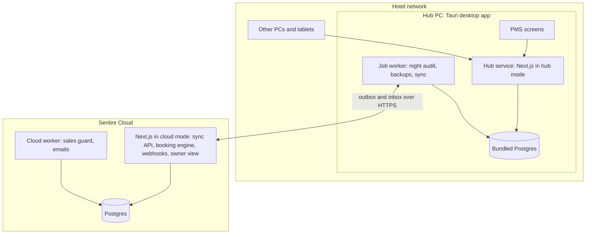

# Sentire PMS: Blueprint

**Version 1.1, 24 November 2026.** Working name "Sentire PMS". Version 1.1: installed Windows app with a property hub that works offline, tablets as hub clients, Sentire Cloud for online sales and backups. This blueprint fixes what the product is, who it is for, what is in each release, and how it is built. The System Design gives the requirements and models; the Build Plan gives the order of work.

---

## 1. Product in one page

**What it is.** An installed, offline-capable property management system for independent Philippine hotels, resorts, inns and hostels. It runs the front desk (reservations, calendar, check-in and check-out), the money (folios, payments, BIR-ready invoices) and direct sales (a commission-free booking engine), in one app. It installs on the hotel's Windows PC as the **property hub**, keeps working when the internet is down, and syncs with Sentire Cloud for the booking engine, online payments, backups and remote owner access.

**Who it is for.** Properties with 5 to 80 rooms that today use paper, Excel, or an expensive foreign PMS. The buyer is the owner or general manager; the daily users are front desk staff and housekeepers.

**Why it can win locally.**

1. Works through internet outages, which matter for resorts and provincial hotels; cloud-only systems such as Cloudbeds need a working internet connection.

1. Built for Philippine rules from day one: VAT-inclusive pricing, senior citizen and PWD discounts, BIR invoice format and reports, LGU fees.
2. Local payments: GCash, Maya and cards through pay-by-link and the booking engine, with peso payouts.
3. Priced in pesos for small properties, supported in English and Filipino.
4. Familiar workflow: the screens follow the proven Cloudbeds layout (calendar, reservation drawer, folio), so staff who have used a modern PMS feel at home.

**What it is not (for now).** Not a channel manager (we connect to a partner in P2), not a revenue management system, not a marketing suite, not a POS. These are separate products inside Cloudbeds and would dilute a one-person build.

**Reference material.** Cloudbeds PMS Replication Analysis (24 Nov 2026); clickable mockup https://claude.ai/artifact/38WkRbrpdW9NDpLtNAgEAf.

---

## 2. Release scope

| Module | MVP (first paying property) | P2 | Later |
|---|---|---|---|
| Property setup | Property, room types, rooms, blocks, taxes and fees | Photos gallery, amenities | |
| Rates and availability | Rate plans (standard, derived, package), daily rates and restrictions, bulk update, policies | Seasons and rate templates | RMS recommendations |
| Reservations | Create, edit, cancel, no-show, room assignment, search, notes, activity log | Split stays, waitlist | Groups and allotments |
| Calendar | 7, 14, 30 day views, drag and drop, inline rate edit, blocks | Multi-property view | |
| Front desk | Dashboard, check-in, check-out, registration card, ID capture | Pre-check-in form for guests | Door-lock keys |
| Housekeeping | Room condition board (mobile), auto Dirty on check-out | Assignments and printable sheets | Tickets and maintenance |
| Folio and payments | Multiple folios, charges, payments, refunds, pay-by-link (Maya, PayMongo), webhooks | City ledger accounts | Card terminal integration |
| Invoicing | Sequential invoices with VAT, exempt sales, SC and PWD discounts | Credit notes | eInvoicing to BIR when required |
| Booking engine | Search, cart, checkout with deposit, confirmation email, manage booking | Promo codes, Filipino language, display currency | Website builder |
| Night audit and reports | Night audit job, 10 core reports, Excel and PDF export | Scheduled report emails | Custom report builder |
| Users and security | Sentire Account sign-in, roles per property, audit log | Two-factor sign-in | SSO for groups |
| Messaging | Confirmation and cancellation emails | Unified inbox, SMS, automated journeys | WhatsApp, Viber |
| Distribution | | Channel manager partner (Agoda, Booking.com, Expedia) | Direct OTA connections |
| Multi-property | Data model supports it | Property switcher, portfolio reports | Central reservations |
| AI | | | Claude assistant as paid add-on |
| Installed apps | Windows desktop app with built-in hub, signed installer, auto-update | Android and iPad tablet apps (hub clients) | macOS desktop app |
| Offline and sync | Full offline operation on the hotel network, two-way sync, online sales guard, hourly local and nightly cloud backup, hub replacement wizard | Owner read-only cloud view | |

---

## 3. Screens (from the mockup)

| Screen | Purpose | Mockup artboard |
|---|---|---|
| Dashboard | Today's activity, occupancy, forecast | Main |
| Calendar | Rooms x dates with booking bars and side drawer | Calendar |
| Reservations | Filterable list | Reservations |
| Reservation detail | Tabs: Accommodations, Folio, Guest details, Notes, Activity | Reservation |
| New reservation | Availability, cart, guest | NewReservation |
| Housekeeping | Room condition board | Housekeeping |
| Guests | Profiles and stay history | Guests |
| Inbox (P2) | Guest messages | Inbox |
| Rates and availability | Matrix, bulk update, rate plans, policies | Rates |
| Payments | Overview, transactions, payouts, disputes | Payments |
| Reports | Report library and viewer | Reports |
| Settings | Property, rooms, taxes, users, channels | Settings |
| Booking engine | Guest-facing booking and checkout | BookingEngine |

---

## 4. Architecture

### 4.1 Shape

Two runtimes, one codebase:

- **Property hub (at the hotel).** The Windows desktop app in hub mode runs the PMS server (the Next.js app in `hub` mode, as a bundled Node service), a bundled Postgres database and the job worker. It is the authority for everything that happens at the property. Other PCs and tablets connect to it over the hotel network.
- **Sentire Cloud.** The same Next.js app in `cloud` mode, on Dokploy: the sync API, the booking engine, payment webhooks, backups and the owner's remote view. It is the authority for online bookings and online payments until the hub has applied them.
- **Desktop and tablet shells.** Tauri 2 apps that show the hub's screens, handle pairing, updates and printing, and (on tablets) keep a small SQLite cache.

Modules inside the app talk through service functions in `src/server/<module>`, never by reaching into each other's tables, and every write also records an outbox event for sync.

### 4.2 Technology stack

Chosen to match Sentire Projects and the Sentire Framework TypeScript kit, so one person can maintain all products the same way.

| Layer | Choice | Why |
|---|---|---|
| App framework | Next.js 16 (App Router), React, TypeScript strict, one app with two run modes (`hub`, `cloud`) | Same as Sentire Projects and Payroll; one codebase for both sides |
| Desktop and tablet shell | Tauri 2 (Windows first; Android and iPadOS in P2; macOS later) | Small installers, one codebase for desktop and mobile, built-in updater |
| Hub runtime | Bundled Node.js running the Next.js standalone server as a Windows service; bundled Postgres 18 binaries | Same SQL and Drizzle schema as the cloud, so no second database dialect |
| Tablet offline cache | SQLite inside the Tauri mobile app | Small, reliable on mobile |
| Sync | Own outbox/inbox protocol over HTTPS (ULID event IDs, per-hub sequence numbers) | Simple, auditable, fits the single-writer-per-property model |
| Updates and code signing | Tauri updater with signed releases on the Sentire update server; Windows code-signing certificate | Avoids Windows SmartScreen warnings; safe staged updates |
| Styling | Tailwind CSS with Sentire design tokens (from sentire-kit), headless components | Matches the mockup's neutral and orange look |
| Database | Cloud: Postgres 18 (shared Dokploy instance), database `sentire_pms`. Hub: bundled Postgres 18 per property | Same engine on both sides |
| ORM and migrations | Drizzle ORM, SQL migrations in `drizzle/`, applied on boot | Same as Sentire Projects |
| Validation | Zod for every input and webhook | One schema for forms, actions and API |
| Auth | Sentire Account through sentire-kit sign-in helpers; own session cookie | One sign-in across Sentire apps |
| Jobs | pg-boss (Postgres-backed queue) in a separate worker process | No extra infrastructure; durable |
| Files | RustFS (S3-compatible), private bucket, signed URLs | Already running |
| Email | Postal (self-hosted) | Already running |
| SMS | Semaphore PH | Local delivery |
| Payments | Provider adapter with Maya for Business and PayMongo implementations | Founder's chosen gateways |
| PDF | Server-side HTML to PDF (Chromium) for invoices and reports | Matches printed layouts exactly |
| Excel | SheetJS | Report exports |
| Tests | Vitest (unit, integration with a test database), Playwright (end-to-end) | Fast, TypeScript-native |
| Errors and logs | Structured JSON logs, Sentry (free tier) | Simple and enough |
| Hosting and CI | Cloud on Dokploy (auto-deploy on push to main); GitHub Actions for lint, type-check, tests and the signed Windows installer build | Existing setup plus a Windows build runner |
| Tracking | Sentire Projects (key to be created) via MCP | Owner's tracking standard |

### 4.3 Multi-tenancy

- The cloud is multi-tenant; a hub holds one property (or one organization's properties at the same site).
- Hierarchy: Organization, then Property. Every tenant row has `organization_id`; property-level rows also have `property_id`.
- A request resolves the current user and property from the session and URL (`/p/[propertySlug]/...`) and passes a `TenantContext` into every service call. Repository functions require it; there is no query helper without a tenant.
- Postgres Row Level Security can be added later as a second guard; the MVP relies on the data-access layer plus isolation tests.

### 4.4 Core data model (tables)

| Area | Tables |
|---|---|
| Tenancy and users | organizations, properties, users, property_roles, sessions, invitations, audit_log |
| Inventory | room_types, rooms, room_blocks, inventory_days |
| Rates | rate_plans, daily_rates, policies, taxes_fees, rate_plan_taxes |
| Guests | guests, guest_documents, guest_merges |
| Reservations | reservations, reservation_rooms, room_nights, reservation_guests, discounts, reservation_notes, reservation_events |
| Money | folios, folio_transactions, payments, payment_links, refunds, invoices, invoice_lines, invoice_sequences, city_ledger_accounts |
| Operations | housekeeping_events, night_audits, business_dates |
| Integration | webhook_events, outbound_messages, jobs (pg-boss schema), channel_mappings (P2) |
| Hub and sync | hubs, devices, outbox_events, inbox_events, sync_cursors, sync_issues, backups |

The class diagrams in the System Design (section 4) are the reference for fields and relationships.

### 4.5 Engineering rules that protect money and inventory

1. **Integer centavos everywhere.** `bigint` columns ending in `_centavos`; formatting only at the edge.
2. **Inventory lock.** Any change that affects availability locks the `inventory_days` rows for the room type and dates (`SELECT ... FOR UPDATE`) inside the same transaction as the reservation write.
3. **No double room.** Unique index on `room_nights (room_id, stay_date) WHERE active`.
4. **Append-only ledger.** `folio_transactions`, `audit_log` and `invoice_lines` reject UPDATE and DELETE by trigger. Corrections are reversing entries.
5. **Invoice numbers.** One `invoice_sequences` row per property and series, incremented with a row lock; numbers are never reused, even if issuing fails after the increment (the gap is logged as a void).
6. **Idempotent webhooks.** Unique `(provider, event_id)` in `webhook_events`; processing happens in a job, not in the HTTP request.
7. **Business date.** Each property has a `business_date`; only night audit changes it.
8. **Time zones.** Timestamps in UTC (`timestamptz`); stay dates as `date`; display in `Asia/Manila`.
9. **Sync rules.** ULID primary keys created where the record is born; every write adds an outbox event in the same transaction; events are applied at most once on each side; invoices are numbered only on the hub; online bookings are re-checked against inventory when the hub applies them, and an overbooking is flagged rather than refused.
10. **Online sales guard.** The cloud stops selling a property whose hub has not synced for 10 minutes and alerts the Owner.

### 4.6 Integrations

| Integration | Direction | MVP behaviour |
|---|---|---|
| Maya for Business / PayMongo | Out and in | Create checkout sessions and payment links; receive signed webhooks; refunds; read payouts for the Payments page |
| Postal | Out | Transactional email with templates per property |
| Semaphore | Out | Pay-by-link and arrival SMS (P2 for arrival SMS) |
| Sentire Account (sentire-kit) | In | Sign-in, app switcher, company header |
| Sentire Ledger | Out (optional, later) | Daily revenue summary as a signed event, when the owner decides to interconnect products |
| Hub sync | Both | Outbox up, online bookings and payment confirmations down, every 15 to 60 seconds when online |
| Update server | Out | Signed installers and updates, staged rings (pilot first) |
| Channel manager partner | Both (P2) | ARI push, booking pull or webhook, mapping of room types and rate plans |

### 4.7 Security and privacy

- Roles checked in every server action through one `authorize(ctx, permission)` helper; permissions listed in `src/server/iam/permissions.ts`.
- ID images and invoices in a private bucket; access by 5-minute signed URLs; never public.
- Guest anonymization replaces personal fields and deletes documents but keeps financial records (amounts, invoice numbers) for tax retention.
- Rate limits on sign-in, booking engine search and checkout creation.
- Secrets only in Dokploy environment variables; `.env.example` lists names, never values. The hub never holds payment provider secret keys; online payments are handled in the cloud.
- Local network: TLS with a per-property certificate, device tokens from pairing (revocable), staff PIN for shared stations.
- Hub PC: Windows BitLocker recommended for the disk; the local database and backups are encrypted at rest with a key held by the hub service.

---

## 5. Design system

The PMS follows the Sentire design direction: neutral greys (like Frappe UI) with orange as the only accent, Inter font, white cards on a light grey canvas, 8 px radius controls, 12 px radius cards. Status colours: blue Confirmed, green Checked in, amber Not confirmed, purple Group, red hatched Out of service. Tokens come from sentire-kit so the PMS stays in step with the other products. The clickable mockup is the visual reference for every MVP screen.

---

## 6. Commercial notes (for the financial model)

These are planning notes, not forecasts. All figures are estimates to be replaced with researched pricing before launch.

- **Pricing unit.** Per property per month, tiered by number of rooms (for example up to 15, 16 to 40, 41 to 80). The booking engine is included because it is the main reason to switch.
- **Payments revenue.** A small margin on online payments is possible only if the provider agreement allows it; until confirmed, model zero.
- **AI cost.** Keep the Claude assistant out of the base plan (consistent with the AI add-on decision for the other products).
- **Hub hardware.** Optionally sell or lease a preconfigured mini PC as the hub (one-time fee). Margin and supplier to be researched.
- **Focus risk.** This is a new product beside Payroll, Ledger, POS and Tax-Filing. The Build Plan sequences it so that no MVP work starts until the owner confirms the PMS is the wedge to pursue now, or a pilot property commits.

---

## 7. Risks

| Risk | Impact | Mitigation |
|---|---|---|
| Building too wide (copying all of Cloudbeds) | MVP never ships | Hard MVP scope in section 2; P2 items need an owner decision to start |
| Double booking from a race condition | Lost trust, refunds | Inventory lock and unique room-night index (4.5), concurrency tests |
| BIR registration delay | Cannot issue invoices from the system at go-live | Start the BIR checklist in Phase 0; allow manual invoice numbering mode for pilot only if the property already has registered receipts |
| OTA connectivity expected by buyers | Lost sales | Be explicit that MVP is direct and walk-in; partner integration first item of P2 |
| Payment provider onboarding time | Booking engine cannot take money | Apply for Maya and PayMongo merchant accounts in Phase 0; support record-only payments meanwhile |
| Solo-founder bandwidth | Slow support | Simple product, good empty states, help text, in-app guides; one pilot property before selling widely |
| Data privacy breach (ID images) | Legal exposure | Private bucket, signed URLs, access logged, retention policy |
| Sync bugs (lost or doubled changes) | Wrong folios or inventory | Single writer per property, at-most-once event apply, sync test suite with network cuts, reconciliation report hub versus cloud |
| Hotel PC failure, theft or power loss | Downtime, data loss | Hourly local and nightly cloud backups, replacement wizard, UPS recommended; optional Sentire-supplied mini PC |
| Unsigned or untrusted installer | Windows blocks install | Code-signing certificate before the pilot; staged update rings |
| BIR treats each hub as a machine to register | Extra registration work per property | Confirm in Phase 0 (CR-07); invoices issued only by the hub |
