# Sentire PMS: System Design

**Version 1.1, 24 November 2026.** Working name "Sentire PMS". Version 1.1 adds the installed, offline-capable design: a Windows desktop app with a built-in property hub, tablet apps as hub clients, and sync with Sentire Cloud. Companion documents: Build Plan, Blueprint, CLAUDE.md, README.md. Reference material: *Cloudbeds PMS Replication Analysis (24 Nov 2026)* and the clickable mockup at https://claude.ai/artifact/38WkRbrpdW9NDpLtNAgEAf.

**How to read this document.** Section 1 states what the system must do and how well. Section 2 names who uses it. Section 3 describes the most important use cases step by step. Section 4 gives the class model. Section 5 gives the activity diagrams for the main workflows. Section 6 adds two supporting views (the reservation life cycle and the deployment). Requirement IDs (FR, NFR, CR) are referenced by the Build Plan and by UAT documents.

**Priority key.** MVP = needed before the first paying property. P2 = second release. Later = after product-market fit.

---

## 1. System Requirements

### 1.1 Functional requirements

#### Property setup and inventory

| ID | Requirement | Priority |
|---|---|---|
| FR-01 | An Owner can create an organization and one or more properties, each with name, registered business name, TIN and branch code, address, currency (PHP), time zone (Asia/Manila), check-in and check-out times. | MVP |
| FR-02 | An Admin can define room types (private room, dorm bed, virtual), with capacity, description, photos and base rate. | MVP |
| FR-03 | An Admin can create rooms (or beds) under a room type with a room number and an active flag. | MVP |
| FR-04 | An Admin can block a room for a date range as Out of service, Owner stay or Courtesy hold, with a reason. Blocked rooms are removed from sellable inventory. | MVP |
| FR-05 | An Admin can configure taxes, fees and discounts: percentage or fixed, per night, per stay, per guest or per reservation, included in or added to the rate, each linked to a GL account code. | MVP |

#### Rates, availability and policies

| ID | Requirement | Priority |
|---|---|---|
| FR-06 | An Admin can create rate plans of type Standard, Derived (percentage or fixed from a parent plan) and Package (rate plus included items). | MVP |
| FR-07 | An Admin can set a rate per room type, rate plan and date, and restrictions per date: minimum stay, maximum stay, closed, closed to arrival, closed to departure. | MVP |
| FR-08 | An Admin can bulk update rates and restrictions for a date range, selected days of the week and selected room types, by Set to, Increase by or Decrease by (amount or percent). | MVP |
| FR-09 | An Admin can define deposit and cancellation policies (guarantee amount, free-cancellation window, late cancellation and no-show penalty) and attach one policy to each rate plan. | MVP |
| FR-10 | The system computes availability per room type and date as rooms of the type, minus blocked rooms, minus booked room-nights, and never allows availability below zero unless an Admin explicitly overbooks. | MVP |

#### Reservations

| ID | Requirement | Priority |
|---|---|---|
| FR-11 | A Front Desk Agent can create a reservation with source, dates, one or more rooms (room type, rate plan, guests) and a main guest, and see live availability while doing it. | MVP |
| FR-12 | A reservation moves through the statuses Inquiry, Not confirmed, Confirmed, Checked in, Checked out, Cancelled and No-show, following the state machine in section 6.1. | MVP |
| FR-13 | A Front Desk Agent can assign, change or unassign a room, including by drag and drop on the calendar; the system rejects an assignment that collides with another stay or block. | MVP |
| FR-14 | A Front Desk Agent can change dates, add or remove rooms, and the system re-prices the stay and re-checks availability. | MVP |
| FR-15 | A Front Desk Agent can cancel a reservation or mark it No-show; the system applies the attached policy and posts any penalty to the folio. | MVP |
| FR-16 | Users can search reservations and guests from one search box by name, reservation number, email or phone, and filter the reservation list by status, dates, source and room type. | MVP |
| FR-17 | Every reservation keeps notes, attached documents and an activity log (who did what and when). | MVP |

#### Front desk and housekeeping

| ID | Requirement | Priority |
|---|---|---|
| FR-18 | The dashboard shows, for the business date, arrivals, departures, in-house, stayovers, new bookings, cancellations and overbookings, with occupancy and a 14-day forecast. | MVP |
| FR-19 | The calendar shows rooms by type against dates (7, 14 or 30 days), with reservations as colour-coded bars, blocks, daily occupancy, availability and rate. | MVP |
| FR-20 | A Front Desk Agent can check a guest in (room must be assigned and, by setting, Clean or Inspected) and check a guest out (balance must be zero or moved to a city ledger account). | MVP |
| FR-21 | A Front Desk Agent can record guest details and identity documents, print a registration card, and record senior citizen or PWD ID details where a discount is claimed. | MVP |
| FR-22 | Housekeepers and Front Desk Agents can set each room's condition (Dirty, Clean, Inspected); check-out sets the room to Dirty automatically. | MVP |
| FR-23 | The housekeeping board shows each room's condition, front desk status (arrival, departure, stayover, turnover, vacant, out of service) and assigned housekeeper. | MVP |

#### Folio, payments and invoicing

| ID | Requirement | Priority |
|---|---|---|
| FR-24 | Every reservation has at least one folio; users can open more folios and move or route charges between them. | MVP |
| FR-25 | The system posts room revenue and the configured taxes and fees for each night automatically at night audit. Users can post product charges, adjustments, cancellation fees and no-show fees. | MVP |
| FR-26 | Posted folio transactions are never edited or deleted; corrections are made with a reversing transaction. | MVP |
| FR-27 | A Front Desk Agent can record payments by cash, card terminal, bank transfer or city ledger, and take online payments through the payment provider (card, GCash, Maya) using a pay-by-link sent by email or SMS. | MVP |
| FR-28 | The system updates the folio automatically when the payment provider confirms a pay-by-link or booking-engine payment (webhook), exactly once per payment. | MVP |
| FR-29 | A Front Desk Agent can refund all or part of a payment, back through the provider where possible. | MVP |
| FR-30 | The system issues sequentially numbered invoices for a folio, showing VATable sales, VAT, VAT-exempt sales and senior citizen or PWD discounts, in the format the BIR permits for the registered system. | MVP |
| FR-31 | An Admin can keep city ledger (accounts receivable) accounts for companies and travel agents, move folio balances to them and record their payments. | P2 |

#### Booking engine (guest-facing)

| ID | Requirement | Priority |
|---|---|---|
| FR-32 | A Guest can search availability for dates and guest count, see room types with photos, rate plans and policies, and add one or more rooms to a cart. | MVP |
| FR-33 | A Guest can enter details, accept terms and pay the deposit online; the reservation is created as Confirmed only after the payment succeeds. | MVP |
| FR-34 | A Guest receives a confirmation email with a link to view or cancel the booking within the policy. | MVP |
| FR-35 | The booking engine supports promo codes, English and Filipino, and display currencies (charging stays in PHP). | P2 |

#### Night audit and reports

| ID | Requirement | Priority |
|---|---|---|
| FR-36 | Night audit runs automatically at a set time (default 2:00 AM) or manually by a Manager. It checks unprocessed arrivals and departures, posts room revenue, processes no-shows, balances payments to the cash count, and rolls the business date. | MVP |
| FR-37 | Reports: Arrivals, Departures, In-house, Daily revenue, Occupancy and ADR and RevPAR, Revenue by source, Payments by method, Cash count, Sales summary for BIR, Night audit summary. All export to Excel and PDF. | MVP |
| FR-38 | Users can schedule a report to be emailed daily, weekly or monthly. | P2 |

#### Users, security and administration

| ID | Requirement | Priority |
|---|---|---|
| FR-39 | Users sign in with one Sentire Account (sentire-kit) and hold a role per property: Owner, Administrator, Front Desk, Housekeeping, Accountant. A user can hold different roles at different properties. | MVP |
| FR-40 | An Owner or Administrator can invite, deactivate and change the roles of users. | MVP |
| FR-41 | The system keeps an append-only audit log of sign-ins, permission changes and every create, update, status change and money movement. | MVP |

#### Guest messaging, distribution and growth

| ID | Requirement | Priority |
|---|---|---|
| FR-42 | The system sends automated emails: booking confirmation, pre-arrival with pre-check-in form, post-stay thank-you. | MVP (confirmation), P2 (others) |
| FR-43 | A unified inbox shows guest emails, SMS and OTA messages per reservation, with replies from the PMS. | P2 |
| FR-44 | Rates, availability and restrictions sync both ways with OTAs (Agoda, Booking.com, Expedia) through a channel manager partner; OTA bookings, changes and cancellations arrive as reservations automatically. | P2 |
| FR-45 | Multi-property: switch properties, a multi-view dashboard, and portfolio reports. | P2 |
| FR-46 | Groups: allotment blocks with release dates, quotes, rooming lists. | Later |
| FR-47 | Tickets and maintenance tasks with checklists. | Later |
| FR-48 | AI assistant (Claude): answer staff questions about the property's data, draft guest replies, read uploaded IDs. Offered as a paid add-on, routed to Haiku by default. | Later |

#### Installed apps, offline operation and sync

| ID | Requirement | Priority |
|---|---|---|
| FR-49 | Sentire PMS installs as a signed Windows desktop app (Windows 10 and 11, 64-bit) with automatic, signed updates. | MVP |
| FR-50 | One installation per property runs in **hub mode**: it holds the property's database and serves every other device on the hotel network. An Admin pairs other devices to the hub with a one-time code or QR code. | MVP |
| FR-51 | All front desk, housekeeping, folio, record-only payment, invoicing, night audit and report functions work with no internet connection, as long as the device can reach the hub on the local network. | MVP |
| FR-52 | The hub syncs with Sentire Cloud in both directions whenever the internet is available: property changes go up, online bookings and online payment confirmations come down. Sync resumes after any outage without losing or duplicating changes. | MVP |
| FR-53 | Every screen shows the connection state (Online, Offline since time, Syncing, number of changes waiting). | MVP |
| FR-54 | **Online sales guard.** The cloud booking engine stops selling a property whose hub has not synced for more than 10 minutes (setting), and resumes automatically after the next successful sync. | MVP |
| FR-55 | The hub backs up its database automatically: every hour to a second local disk or folder, and nightly (encrypted) to Sentire Cloud. A restore wizard rebuilds a hub on a replacement PC from the latest cloud backup. | MVP |
| FR-56 | Owners can open a read-only view of dashboard and reports from anywhere through the cloud (data as of the last sync). | P2 |
| FR-57 | Android and iPad tablet apps connect to the hub as clients for the housekeeping board and front desk, and keep a small offline copy (today's rooms and arrivals) that sends changes when reconnected. | P2 |
| FR-58 | A macOS desktop app with the same features as Windows. | Later |

### 1.2 Non-functional requirements

| ID | Category | Requirement |
|---|---|---|
| NFR-01 | Performance | Dashboard, calendar (14 days, 50 rooms) and reservation pages load in under 1.5 s at the 95th percentile on a 20 Mbps connection. Availability search on the booking engine answers in under 800 ms. |
| NFR-02 | Correctness under concurrency | Two users or channels booking the last room at the same moment must never both succeed. Inventory changes run in one database transaction that locks the affected room-type-date rows. |
| NFR-03 | Availability | Property operations depend only on the hub and the local network, not on the internet. Cloud services (booking engine, payments, sync endpoint) target 99.5% monthly uptime. Night audit must complete even if the hub restarts (durable job queue). |
| NFR-04 | Data durability | Hub: hourly local backup and nightly encrypted cloud backup (recovery point 1 h locally, 24 h if the PC is lost; with internet, sync shortens this to minutes). Cloud: nightly encrypted backups kept 14 days and an off-server copy, restore tested monthly. Recovery time objective 4 h, including setting up a replacement hub PC. |
| NFR-05 | Security | HTTPS only; session cookies HttpOnly, Secure, SameSite=Lax; role checks on every server action and API route; secrets only in Dokploy environment variables; card data never touches Sentire servers (provider-hosted fields and tokens only). |
| NFR-06 | Tenant isolation | Every tenant-owned row carries organization_id and property_id; all queries go through a data-access layer that requires the current tenant; integration tests prove one property cannot read another's data. |
| NFR-07 | Auditability | Folio transactions and the audit log are append-only at the application level and protected by a database trigger. |
| NFR-08 | Money | All amounts stored as integer centavos (bigint) with currency PHP; rounding rules defined once (half-up at the line level). |
| NFR-09 | Time | Store timestamps in UTC; display in the property time zone; stays are keyed by date (no time), and every operational screen uses the property's business date, not the clock date. |
| NFR-10 | Usability | Works on desktop browsers (latest Chrome, Edge, Safari, Firefox) and tablets; booking engine is mobile-first. WCAG 2.1 AA for colour contrast and keyboard use. |
| NFR-11 | Localization | English UI first; booking engine in English and Filipino in P2. Date format DD Mon YYYY, peso sign with two decimals. |
| NFR-12 | Observability | Structured logs, error tracking, and a health endpoint that Sentire Cloud checks every 60 s. |
| NFR-13 | Maintainability | TypeScript strict mode, unit tests for domain rules, integration tests for each use case, Playwright tests for the top flows; every process ships with a UAT document (Sentire UAT Standard). |
| NFR-14 | Cost | Runs on the existing Dokploy servers and shared Postgres; added running cost for the first 20 properties under PHP 3,000 per month (estimate, excludes payment fees and SMS). |
| NFR-15 | Sync | When online, a change made at the property reaches the cloud within 60 seconds, and an online booking reaches the hub within 60 seconds. |
| NFR-16 | Hub hardware | Hub runs on Windows 10 or 11 64-bit, 4-core CPU, 8 GB RAM, SSD with 20 GB free, wired network recommended, UPS recommended. Up to 15 connected devices per hub. |
| NFR-17 | Updates | Installers and updates are code-signed; updates are staged (pilot ring first), verified by signature, and roll back automatically if the hub fails its health check after updating. Database migrations run only on the hub, never on clients. |
| NFR-18 | Local network security | Devices talk to the hub over TLS with a per-property certificate; each device has a revocable device token from pairing; staff still sign in with their own account (PIN for quick switching at shared stations). |

### 1.3 Compliance requirements (Philippines)

These are design obligations, not legal advice. Each must be confirmed against the current rules before launch.

| ID | Requirement |
|---|---|
| CR-01 | **BIR registration of the system.** A system that issues invoices must be registered with the BIR for the property's use (CAS/CRM rules) before go-live. Invoice numbering, required fields, the sales journal and the audit trail must follow the approved format. The existing *Sentire POS BIR Accreditation Runbook* in this Project is the starting point; the PMS gets its own checklist. |
| CR-02 | **Invoicing under the EOPT Act (RA 11976).** The invoice is the primary sales document for both goods and services. Invoice layout must support VATable, VAT-exempt and zero-rated sales and show VAT separately. |
| CR-03 | **Senior citizen and PWD discounts (RA 9994, RA 10754).** 20% discount and VAT exemption on the qualifying guest's share of room and food charges, with the ID number and name recorded on the invoice and in a discount report. |
| CR-04 | **Data Privacy Act (RA 10173).** Collect only needed guest data, record consent for marketing, protect ID images (private storage, signed URLs), honour access and erasure requests (anonymize guest profiles), keep a breach response procedure, and appoint a data protection officer for Sentire. |
| CR-05 | **Payment data.** Use the provider's hosted checkout and tokens so Sentire stays out of card data scope (PCI DSS SAQ A level). |
| CR-07 | **Installed software and BIR.** Because invoices are issued by software installed at the property, confirm whether the BIR registration must list each hub machine (serial number, machine ID), as with POS terminals, and whether invoice series must be per machine. Until confirmed, invoices are issued only by the hub, never by a client device or the cloud. |
| CR-06 | **Local fees.** Support LGU-specific charges (for example local tourism or environmental fees) as configurable fees, not hard-coded rules. |

### 1.4 Constraints and assumptions

- One developer (the founder) building with Claude Code. Scope must favour depth over breadth.
- Hosting: Sentire Cloud on the existing Dokploy app server, shared Postgres 18, RustFS object storage, Postal email. The hub runs on the hotel's own Windows PC (or a mini PC Sentire can supply).
- Platform order: Windows desktop with hub first; Android and iPad tablets second; macOS later.
- Payment providers: Maya for Business and PayMongo (pay links, checkout, webhooks).
- Channel connectivity in P2 is bought from a channel manager partner, not built per OTA.
- Target customers: independent Philippine hotels, resorts, inns and hostels with 5 to 80 rooms.

---

## 2. System Actors

### 2.1 Human actors

| Actor | Who | Main goals | Access |
|---|---|---|---|
| Owner | Property or group owner | See performance, control users, billing and settings | Everything for their organization |
| Administrator (Manager) | General manager or supervisor | Configure rates, policies, rooms; override; run night audit | All property functions except Sentire billing |
| Front Desk Agent | Receptionist, reservations or call-centre agent | Book, check in and out, take payments, answer guests | Reservations, guests, folios, payments, housekeeping view |
| Housekeeper | Room attendant, housekeeping supervisor | Know which rooms to clean, mark rooms clean or inspected | Housekeeping board only (mobile-friendly) |
| Accountant | In-house or external bookkeeper | Reconcile payments, pull revenue and BIR reports | Reports, folios, invoices (read only) |
| Guest | Traveller booking direct | Find a room, pay, manage the booking | Public booking engine and booking link |

### 2.2 System actors

| Actor | Role |
|---|---|
| Payment Provider (Maya, PayMongo) | Hosts checkout and pay links, tokenizes cards, sends payment webhooks, processes refunds and payouts |
| Channel Manager Partner (P2) | Pushes rates and availability to OTAs, delivers OTA bookings, changes and cancellations |
| Email Service (Postal) | Sends confirmations, pay links, reports |
| SMS Gateway (Semaphore PH) | Sends pay links and arrival messages |
| Property Hub | The installed PMS server and database at the hotel; the authority for property operations |
| Sentire Cloud Sync Service | Receives property changes, delivers online bookings and payment confirmations, enforces the online sales guard |
| Update Server | Publishes signed installers and updates for the desktop and tablet apps |
| Scheduler (pg-boss job queue) | Runs night audit, scheduled charges, report emails, sync retries (on the hub and in the cloud) |
| Sentire Account (sentire-kit) | Single sign-on and the Sentire app switcher |
| Object Storage (RustFS) | Stores ID images, documents, invoice PDFs |

### 2.3 Actors and the parts of the system they use

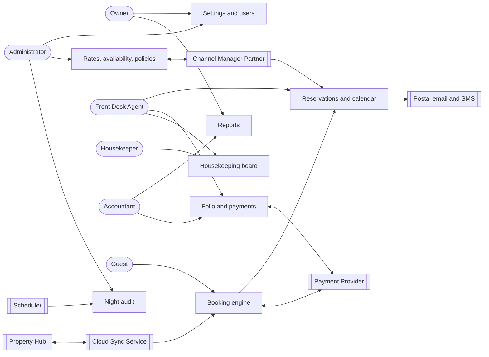

---

## 3. Top Use Cases

### 3.1 Use case overview

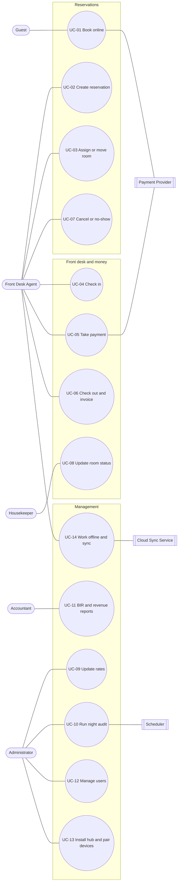

### 3.2 Use case descriptions

#### UC-01 Book online (booking engine)

- **Actors:** Guest (primary), Payment Provider.
- **Requirements:** FR-32, FR-33, FR-34, NFR-02.
- **Preconditions:** The property's booking engine is published; at least one rate plan is open for online sale.
- **Main flow:**
  1. Guest enters check-in, check-out and number of guests.
  2. System shows room types with availability, rate plans, total price including taxes, and the policy for each plan.
  3. Guest adds one or more rooms to the cart and continues.
  4. Guest enters name, email and mobile and accepts the terms and policy.
  5. System places a hold on the selected inventory for 15 minutes and creates a pending reservation.
  6. System opens the provider's hosted checkout for the deposit amount (GCash, Maya or card).
  7. Provider confirms payment by webhook.
  8. System confirms the reservation, posts the payment to the folio, releases the hold into a booking and emails the confirmation.
- **Alternate flows:**
  - 2a. No availability: system suggests other dates.
  - 5a. Inventory taken by another booking between steps 3 and 5: system tells the guest and returns to step 2.
  - 7a. Payment fails or the guest abandons: hold expires after 15 minutes, pending reservation is cancelled, inventory returns.
  - 7b. Webhook arrives twice: second one is ignored (idempotency key).
- **Postconditions:** Confirmed reservation, folio with a payment, inventory reduced, guest emailed.

#### UC-02 Create reservation (front desk, phone or walk-in)

- **Actors:** Front Desk Agent.
- **Requirements:** FR-11, FR-10, FR-16, FR-17.
- **Preconditions:** Agent is signed in with the Front Desk role or higher.
- **Main flow:**
  1. Agent selects source (phone, walk-in, email, corporate, travel agent) and dates.
  2. System shows live availability and prices per room type and rate plan.
  3. Agent adds rooms to the cart, picks or creates the guest (system offers matching existing profiles).
  4. Agent saves; system locks inventory, creates the reservation as Confirmed (or Not confirmed if a guarantee is still due) and opens the main folio.
  5. System sends the confirmation and, if a deposit is due, offers to send a pay-by-link (UC-05).
- **Alternate flows:**
  - 2a. Room type full: Administrator may overbook with a reason (logged).
  - 3a. Guest has a duplicate profile: agent picks the existing one; merge is suggested later.
- **Postconditions:** Reservation and folio exist; activity log records the creator.

#### UC-03 Assign or move room

- **Actors:** Front Desk Agent.
- **Requirements:** FR-13, FR-19.
- **Main flow:**
  1. Agent drags a reservation bar on the calendar to another room or dates, or chooses a room in the reservation.
  2. System checks for collisions with other stays and blocks, room type change and price change.
  3. If the room type or dates change the price, system shows the difference and asks to keep or re-price.
  4. Agent confirms; system saves and logs the move.
- **Alternate flows:** 2a. Collision: system refuses and highlights the conflicting booking.

#### UC-04 Check in

- **Actors:** Front Desk Agent.
- **Requirements:** FR-20, FR-21, FR-22, CR-03.
- **Preconditions:** Reservation is Confirmed; arrival date is the business date (or an early arrival is allowed by setting).
- **Main flow:**
  1. Agent opens the arrival from the dashboard.
  2. System checks that a room is assigned and clean or inspected.
  3. Agent confirms guest details, scans or uploads the ID, records senior citizen or PWD ID if claimed.
  4. System shows the balance and the guarantee rule; agent collects payment if required (UC-05).
  5. Agent prints or e-signs the registration card and confirms check-in.
  6. System sets status Checked in, room to Occupied, and issues key or door code (later, with door-lock integration).
- **Alternate flows:** 2a. Room dirty: agent picks another clean room or asks housekeeping to prioritise it. 4a. Guest cannot pay the deposit: Administrator override with reason.

#### UC-05 Take payment

- **Actors:** Front Desk Agent, Payment Provider.
- **Requirements:** FR-27, FR-28, FR-29, CR-05.
- **Main flow (pay-by-link):**
  1. Agent chooses Add payment, picks the folio, amount and method Pay by link.
  2. System creates a payment link with the provider and sends it by email or SMS.
  3. Guest pays; provider sends a webhook.
  4. System verifies the webhook signature, records the payment on the folio once, and notifies the agent.
- **Alternate flows:** 1a. Cash, card terminal or bank transfer: agent records the payment directly with a reference. 3a. Link expires: status Expired, agent may resend.

#### UC-06 Check out and invoice

- **Actors:** Front Desk Agent.
- **Requirements:** FR-20, FR-24 to FR-30, CR-01 to CR-03.
- **Main flow:**
  1. Agent opens the departure.
  2. System shows all folios with charges, payments and balance.
  3. Agent posts any last charges (minibar, late check-out) and collects the balance (UC-05) or moves it to a city ledger account.
  4. Agent issues the invoice; system assigns the next invoice number, computes VAT and discounts, stores the PDF.
  5. Agent confirms check-out; system sets status Checked out and the room to Dirty.
- **Alternate flows:** 3a. Balance not zero and no city ledger: check-out is blocked. 4a. Guest wants the invoice in a company's name and TIN: agent edits the bill-to before issuing.

#### UC-07 Cancel or mark no-show

- **Actors:** Front Desk Agent (cancel), Scheduler (no-show during night audit).
- **Requirements:** FR-15, FR-09, FR-26.
- **Main flow:**
  1. Agent selects Cancel and a reason.
  2. System evaluates the policy at the current time (free window or penalty).
  3. System shows the penalty and any refundable amount; agent confirms.
  4. System sets status Cancelled, releases inventory, posts the cancellation fee, and offers a refund of the remainder (UC-05 refund).
- **Alternate flows:** No-show: at night audit, unarrived confirmed reservations for the closing date are marked No-show and the no-show fee is posted.

#### UC-08 Update room status

- **Actors:** Housekeeper, Front Desk Agent.
- **Requirements:** FR-22, FR-23.
- **Main flow:** Housekeeper opens the board on a phone, filters to assigned rooms, taps a room to set Clean; supervisor sets Inspected. System timestamps each change and updates the front desk view live.

#### UC-09 Update rates and restrictions

- **Actors:** Administrator; Channel Manager Partner (P2).
- **Requirements:** FR-06 to FR-08, FR-44.
- **Main flow:**
  1. Administrator opens Bulk update, picks dates, days of week, room types and rate plans.
  2. Administrator sets the change (Set, Increase or Decrease by amount or percent) and restrictions.
  3. System previews the affected cells, then applies them in one transaction.
  4. Derived rate plans recalculate; system queues a sync to channels (P2).
- **Alternate flows:** 3a. A change would set a rate below the plan's minimum: system rejects those cells and lists them.

#### UC-10 Run night audit

- **Actors:** Scheduler (primary), Administrator.
- **Requirements:** FR-36, FR-25, NFR-03.
- **Main flow:** see activity diagram 5.5.
- **Postconditions:** Room revenue posted for the closing date; no-shows processed; audit summary stored; business date moved forward by one day.

#### UC-11 Produce BIR and revenue reports

- **Actors:** Accountant, Owner.
- **Requirements:** FR-37, CR-01 to CR-03.
- **Main flow:** Accountant picks the report and period; system builds it from posted transactions and issued invoices only; accountant exports to Excel or PDF. The sales summary ties to the total of invoices issued for the period.

#### UC-12 Manage users and roles

- **Actors:** Owner, Administrator.
- **Requirements:** FR-39, FR-40, FR-41.
- **Main flow:** Owner invites a person by email and sets a role per property; the person signs in with their Sentire Account; every change is written to the audit log. Deactivating a user ends their sessions immediately.

#### UC-13 Install the hub and pair devices

- **Actors:** Administrator, Update Server, Cloud Sync Service.
- **Requirements:** FR-49, FR-50, FR-55, NFR-16, NFR-18.
- **Preconditions:** Property exists in Sentire Cloud (created during sign-up); a Windows PC meets the hub requirements.
- **Main flow:**
  1. Administrator downloads the signed installer and installs it on the chosen PC.
  2. Administrator signs in with the Owner or Admin account and chooses "Make this PC the property hub".
  3. Installer sets up the local database, the hub service (starts with Windows) and the local TLS certificate.
  4. Hub downloads the property's data from the cloud (first sync) and shows the pairing screen.
  5. On each other PC or tablet, staff install the app, find the hub on the network (or scan its QR code) and enter the pairing code.
  6. Hub issues a device token; the device now works with the hub.
- **Alternate flows:**
  - 2a. A hub already exists for the property: the installer offers "Connect to the existing hub" or, for a broken PC, "Replace the hub" (restore from the cloud backup, then revoke the old hub).
  - 5a. Device cannot find the hub: enter the hub's address manually; check that both are on the same network.

#### UC-14 Work offline and sync

- **Actors:** Front Desk Agent (and every staff user), Property Hub, Cloud Sync Service.
- **Requirements:** FR-51 to FR-54, NFR-15.
- **Main flow:**
  1. Internet drops. The hub keeps serving all devices; the status bar shows "Offline since 2:14 PM".
  2. Staff keep working: bookings, check-ins, payments recorded as cash or terminal, invoices.
  3. Every change is written to the hub's outbox in the same transaction as the change.
  4. After 10 minutes without sync, the cloud booking engine stops selling the property (FR-54).
  5. Internet returns. The hub sends its outbox in order; the cloud acknowledges each change once.
  6. The cloud sends anything waiting for the hub (online bookings made before the guard took effect, payment confirmations); the hub applies them, re-checking inventory.
  7. Online sales resume; the status bar shows "Online".
- **Alternate flows:**
  - 6a. An online booking that arrived in the cloud before the guard took effect no longer fits because the room was sold offline: the hub accepts it as an overbooking, flags it on the dashboard, and the front desk relocates or upgrades the guest. The guard window keeps this rare; the overbooking report tracks it.
  - 5a. A change is rejected by the cloud (for example a validation rule changed after an update): it is moved to a "needs attention" list for the Admin, never dropped silently.

---

## 4. Class Diagram

The domain model follows the Cloudbeds public API shape (property, room type, room, rate plan, reservation, booking room, folio, transaction) adapted to Philippine invoicing. It is split into three views for readability. Attributes show the important fields only; every table also has `id`, `organizationId`, `propertyId` (where it applies), `createdAt`, `updatedAt` and `createdBy`.

### 4.1 Organization, property, users and inventory

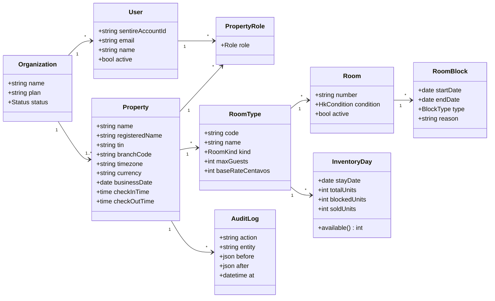

### 4.2 Rates, policies, reservations and guests

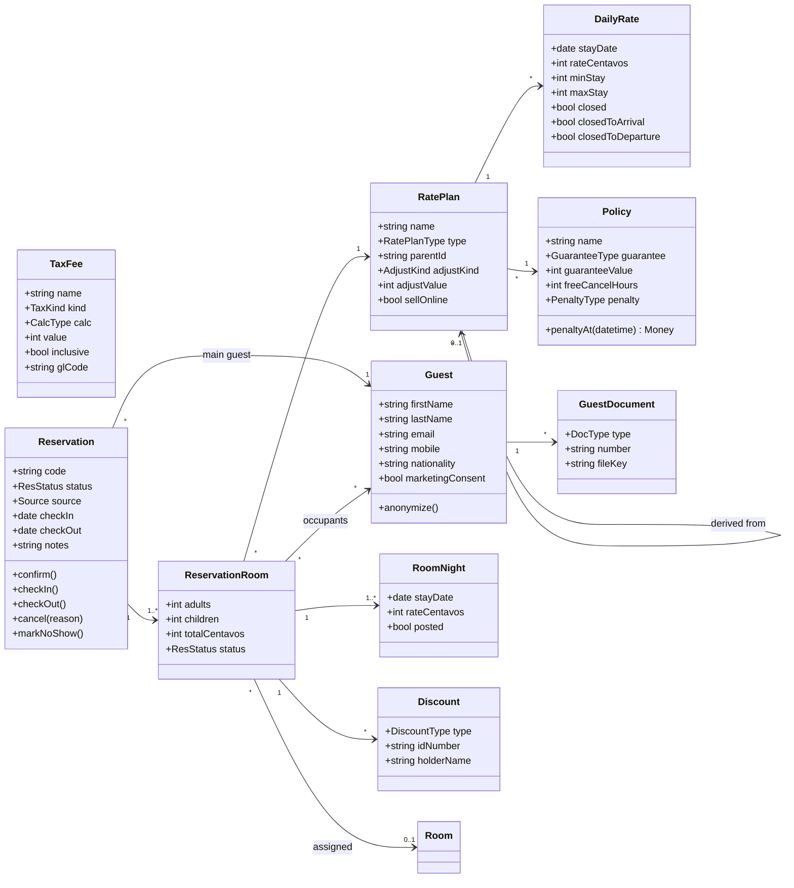

### 4.3 Folio, payments, invoices and night audit

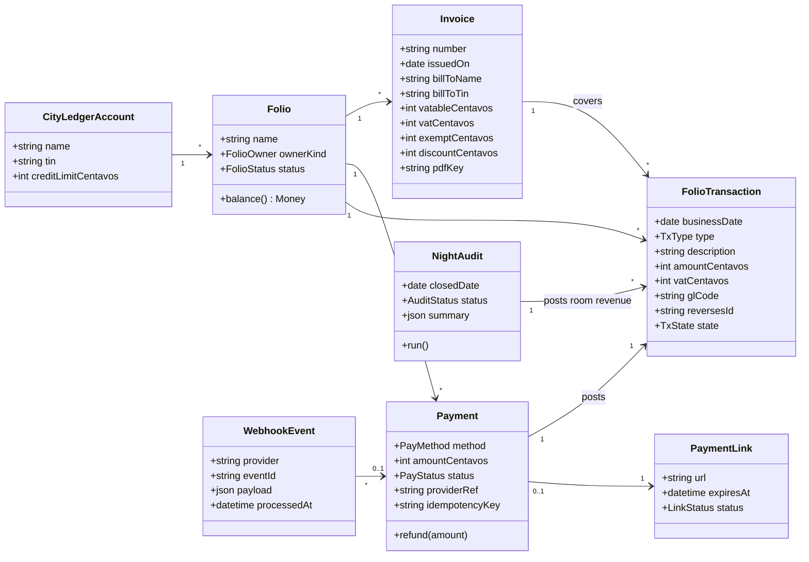

### 4.4 Hub, devices and sync

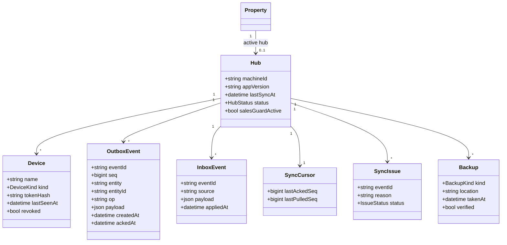

All primary keys are ULIDs generated where the record is created (hub, device or cloud), so records made offline never collide when they sync.

### 4.5 Enumerations

| Enum | Values |
|---|---|
| Role | OWNER, ADMIN, FRONT_DESK, HOUSEKEEPING, ACCOUNTANT |
| RoomKind | PRIVATE, DORM_BED, VIRTUAL |
| HkCondition | DIRTY, CLEAN, INSPECTED |
| BlockType | OUT_OF_SERVICE, OWNER_STAY, COURTESY_HOLD |
| RatePlanType | STANDARD, DERIVED, PACKAGE |
| AdjustKind | PERCENT, FIXED |
| GuaranteeType | NONE, FIRST_NIGHT, PERCENT, FULL_STAY |
| PenaltyType | NONE, FIRST_NIGHT, PERCENT, FULL_STAY |
| ResStatus | INQUIRY, NOT_CONFIRMED, CONFIRMED, CHECKED_IN, CHECKED_OUT, CANCELLED, NO_SHOW |
| Source | DIRECT_ENGINE, WALK_IN, PHONE, EMAIL, CORPORATE, TRAVEL_AGENT, OTA_AGODA, OTA_BOOKING, OTA_EXPEDIA, OTHER |
| TxType | ROOM_REVENUE, TAX, FEE, PRODUCT, ADJUSTMENT, CANCELLATION_FEE, NO_SHOW_FEE, PAYMENT, REFUND, TRANSFER |
| TxState | PENDING, POSTED |
| PayMethod | CASH, CARD_TERMINAL, CARD_ONLINE, GCASH, MAYA, BANK_TRANSFER, CITY_LEDGER |
| PayStatus | PENDING, SUCCEEDED, FAILED, EXPIRED, REFUNDED, PARTIALLY_REFUNDED |
| DiscountType | SENIOR_CITIZEN, PWD, PROMO, MANUAL |
| FolioOwner | RESERVATION, HOUSE_ACCOUNT, CITY_LEDGER |
| HubStatus | ONLINE, OFFLINE, SYNCING, RESTORING, RETIRED |
| DeviceKind | WINDOWS_DESKTOP, ANDROID_TABLET, IPAD, MAC_DESKTOP |
| BackupKind | LOCAL_HOURLY, CLOUD_NIGHTLY, MANUAL |

---

## 5. Activity Diagrams

Lanes show who acts. Diamonds are decisions.

### 5.1 Online booking and payment (UC-01)

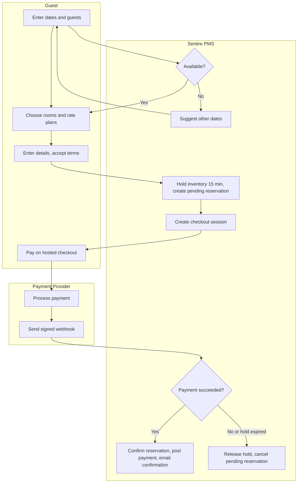

### 5.2 Front desk reservation (UC-02)

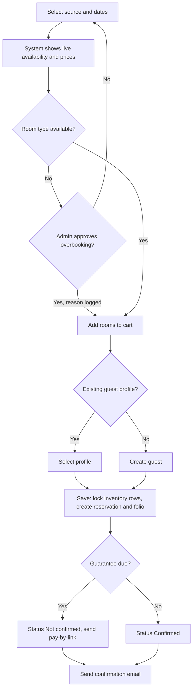

### 5.3 Check-in (UC-04)

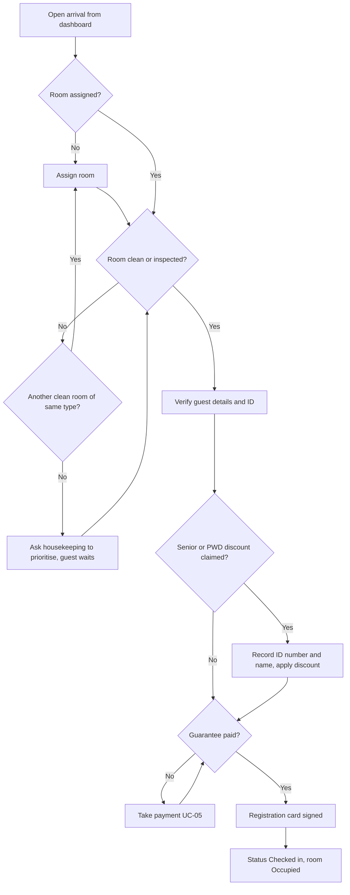

### 5.4 Check-out and invoice (UC-06)

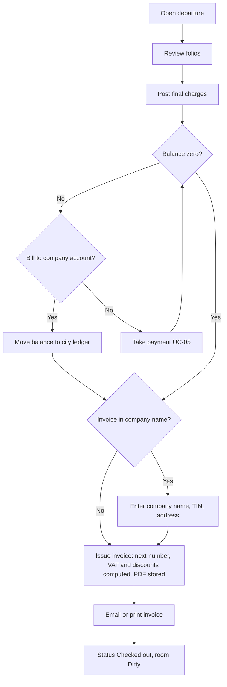

### 5.5 Night audit (UC-10)

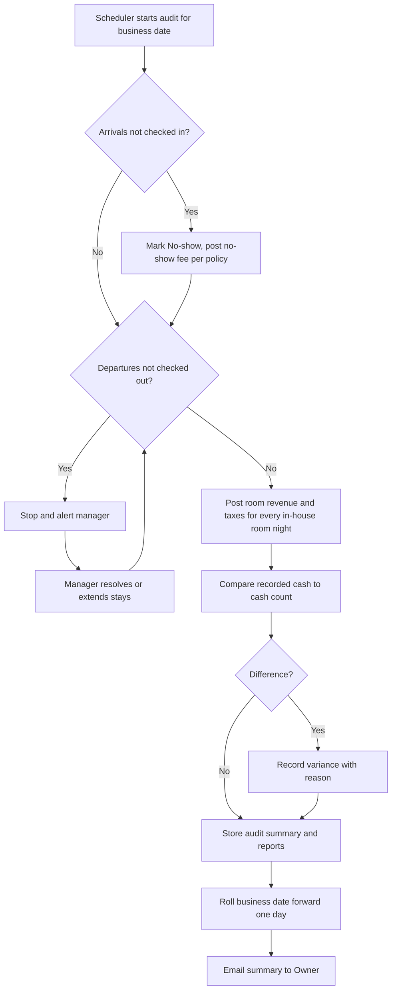

### 5.6 Cancellation (UC-07)

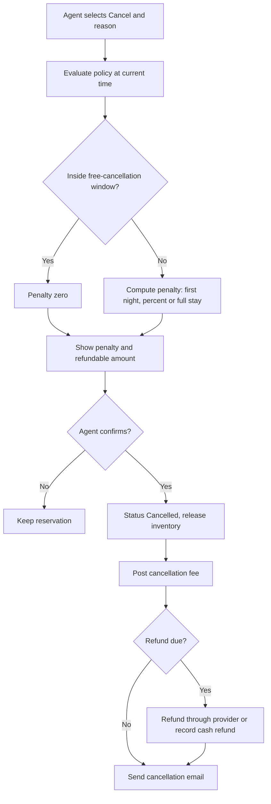

### 5.7 Rate update and channel sync (UC-09)

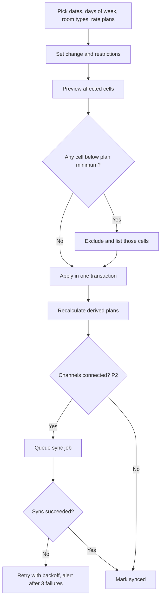

### 5.8 Housekeeping turnover (UC-08)

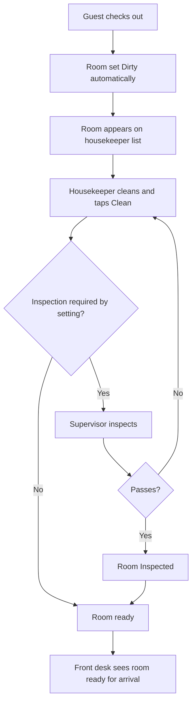

### 5.9 Offline operation and sync (UC-14)

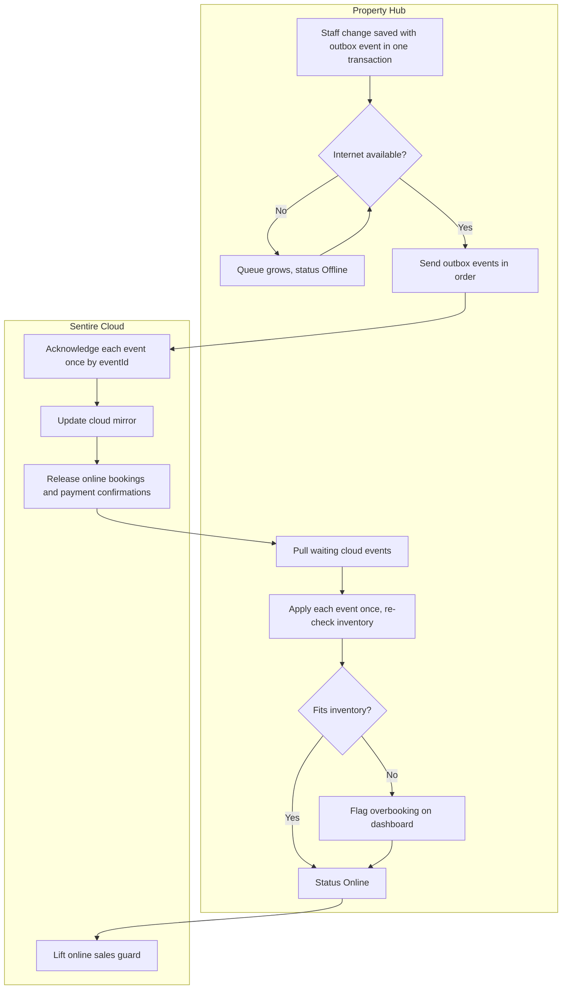

### 5.10 Online sales guard (FR-54)

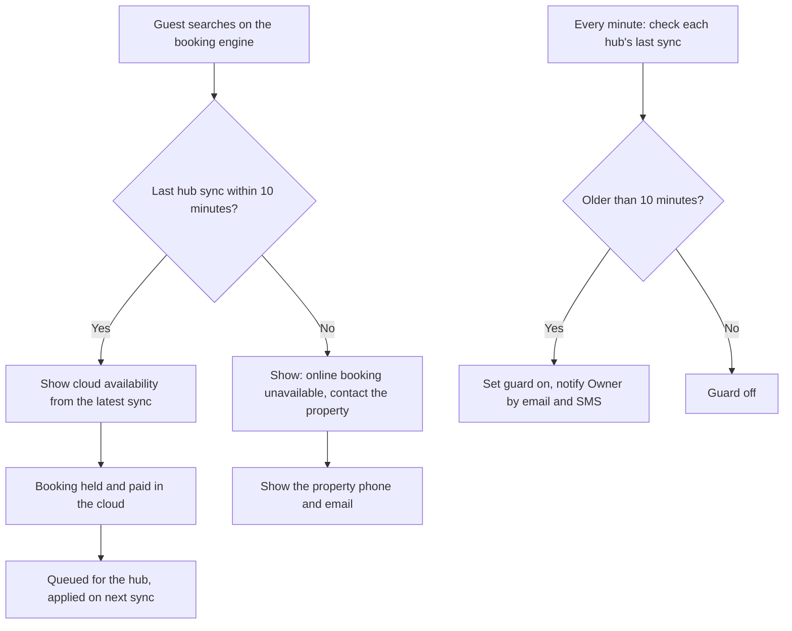

---

## 6. Supporting Views

### 6.1 Reservation state machine

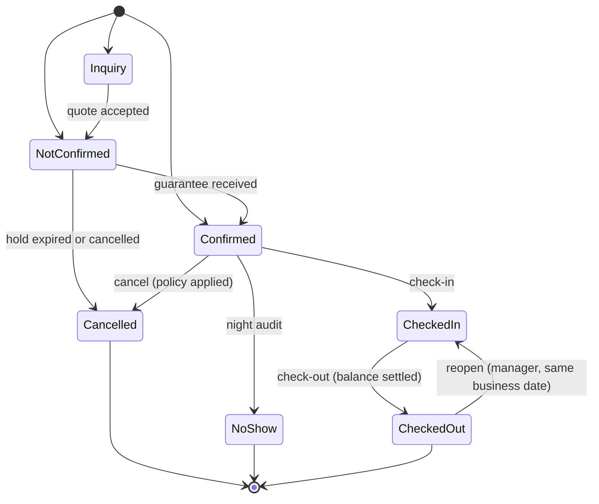

### 6.2 Deployment view

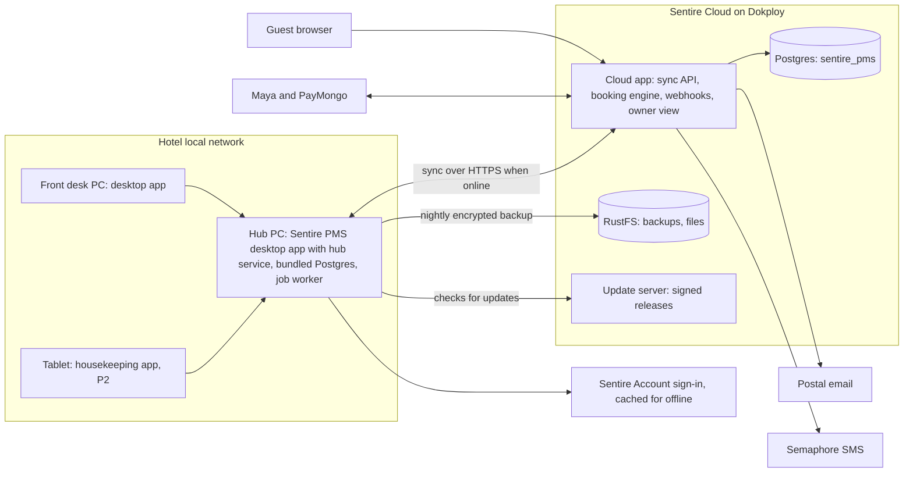

### 6.3 Key design rules

1. **Inventory is the source of truth for availability.** `InventoryDay` rows (room type x date) are updated in the same transaction as the reservation change, with `SELECT ... FOR UPDATE`. A check constraint keeps `soldUnits + blockedUnits <= totalUnits` unless the overbooking flag is set.
2. **Room assignment cannot collide.** `RoomNight` has a unique index on `(roomId, stayDate)` for active stays, so two stays cannot hold the same room on the same night.
3. **Folio is a ledger.** Transactions are append-only; the balance is the sum of posted transactions. Corrections are reversals.
4. **Business date drives operations.** Night audit, not the clock, moves the business date.
5. **Webhooks are idempotent.** `WebhookEvent (provider, eventId)` is unique; a payment is recorded only once.
6. **Money is integer centavos.** VAT is computed per line from the inclusive amount: `vat = round(amount * 12 / 112)`.
7. **Authority is split.** The hub is the authority for everything that happens at the property (reservations made there, room assignment, folios, invoices, night audit, business date). The cloud is the authority for online bookings and online payment confirmations until the hub has applied them.
8. **Every change travels as an event.** Each write on the hub also writes an outbox event in the same transaction. Events carry a ULID `eventId` and a per-hub sequence number; both sides apply an event at most once.
9. **IDs are ULIDs** created on the device that creates the record, so offline records never collide.
10. **Invoices are numbered only on the hub,** from its own sequence, so offline invoicing never produces duplicate numbers (CR-07).
11. **Sign-in works offline.** The hub caches user credentials (hashed) and roles after the first online sign-in; offline sign-in uses the cache, and role changes made in the cloud apply on the next sync.
